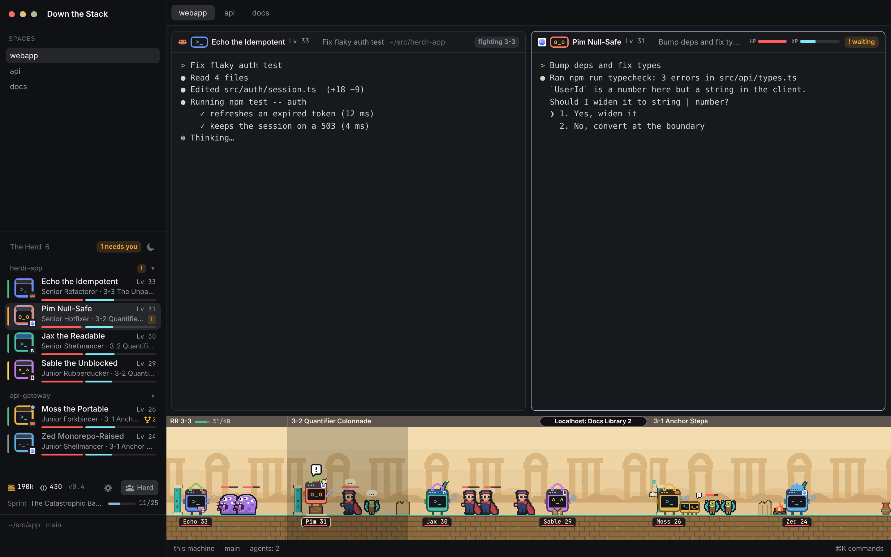

# Down the Stack

An idle side-scrolling dungeon for [herdr](https://herdr.dev). Every coding agent becomes a
**Termling**, a small hero shaped like a terminal window. It fights developer bugs while its agent
works, waits on a crate while the agent needs you, and drops a Commit Chest when the agent ships.
Nothing needs playing: one tick per second, autopilot for everything.



It is a herdr-app 0.1.17 **layout** (`layouts/Down-the-Stack.json`) plus the **mod** it shows
(`mods/mapledr/`). `RECIPE.md` is the brief to rebuild it, and `docs/DESIGN.md` is the full
game design.

## Install

herdr's app home is the same on every OS, macOS and Windows included:
1. `$HERDR_APP_HOME` if set;
2. else `$XDG_CONFIG_HOME/herdr-app`;
3. else `~/.config/herdr-app`.

Below, `<home>` means that folder.

1. **Show another layout first** (for example `ctrl-shift-l`, `cmd-shift-l` on macOS, or Settings).
   - herdr watches `layouts/` and `mods/`, and reloads every copy of a mod that is on screen
     about 150 ms after files change.
   - A slow copy over a running install can load a mix of old and new modules for a moment.
   - Copying to a temporary folder and renaming it into place also avoids this.
2. Copy the files:
   ```sh
   cp layouts/Down-the-Stack.json  <home>/layouts/Down-the-Stack.json
   cp -r mods/mapledr              <home>/mods/mapledr
   ```
   - The mod folder **must be named `mapledr`**. These all use that name:
     - the layout's `"mod": "mapledr"` blocks and its `"preview"` path;
     - the asset root `ASSETS = "mods/mapledr"` (`mods/mapledr/ui/kit.js`);
     - `MOD = "mapledr"` (`mods/mapledr/host.js`).
   - If the name is taken, rename all of them together.
   - The layout file's name is its title in herdr, so keep `Down-the-Stack` unless that is taken
     too.
   - Leave `RECIPE.md`, `preview.png`, `docs/`, `tools/` and `test/` out: the mod needs none of
     them.
3. Check the mod:
   ```sh
   herdr-app check <home>/mods/mapledr
   ```
4. Optional keys: merge the `layout:Down-the-Stack` section of `keys.example.json` into
   `<home>/keys.json`.
   Add the section, and ask yourself before replacing a key you already use. These keys apply only
   while this layout shows:

   | Key | Action |
   |---|---|
   | `ctrl-shift-g` | show or hide the stage strip (`layout.toggle:stage`) |
   | `ctrl-shift-s` | character sheet of the focused agent's hero (`mapledr.sheet`) |
   | `ctrl-shift-a` | Herd panel (`mapledr.herd`) |
   | `ctrl-shift-d` | calm mode (`mapledr.calm`) |

   An untouched `keys.json` is replaced by newer default shortcuts when herdr updates. Once you edit
   it, it is yours, and new default shortcuts must be added by hand.
5. Switch to it in any of these ways:
   - the Settings layout picker (the card is called "Down-the-Stack");
   - the palette row "Layout: Down-the-Stack";
   - the command `layout.switch {"name": "Down-the-Stack"}`;
   - `ctrl-shift-l` cycling (`cmd-shift-l` on macOS).

   Your own layout stays as it was, and the same key switches back.

herdr has no display title for a layout, so Settings, the palette and the macOS View > Layout menu
show the file name, "Down-the-Stack". herdr names mod actions by the mod folder, so the Keys
overlay reads "mapledr sheet" and a failed command toasts `mapledr.sheet failed`. The game itself
only says "Down the Stack".

## What it touches

- It runs no programs and makes no network requests.
- It reads and writes its save in `<home>/data/mapledr/` (`save.json`, a `save.bak` of the
  previous good save, and `save.broken` files that keep aside a save that failed to load).
- It does no IO during `herdr-app check`.

## Update and uninstall

- **Update:** show another layout, replace both copies the same way as installing, run
  `herdr-app check` again, then switch back. The save carries over.
- **Uninstall:** delete `<home>/layouts/Down-the-Stack.json` and `<home>/mods/mapledr/`. Also delete
  `<home>/data/mapledr/` to drop the save. Remove the `layout:Down-the-Stack` section from
  `keys.json` if you merged it.

## Develop

You need Node 22 or later. `npm test`, `npm run check`, `npm run art` and `npm run pacing` use no
packages. `npm run qjs` needs the devDependencies in `package.json`, so run `npm install` once
first. The screenshot commands need Playwright with Chromium, loaded with `require("playwright")`,
so install it where Node finds it.

| Command | What it does |
|---|---|
| `npm test` | unit tests (`node --test "test/*.test.mjs"`) |
| `npm run check` | a Node mock of `herdr-app check` plus every role at several widths and zooms |
| `npm run preview` | HTML renders and screenshots of the roles into `out/` |
| `npm run windows -- --roles --preview` | whole-window screenshots of the demo worlds into `out/` |
| `npm run art` | regenerate `mods/mapledr/art/` and `preview.svg` (never hand-edit art) |
| `npm run pacing` | the headless persona simulator (`-- --sweep` for the full sweep) |
| `npm run qjs` | the mod in QuickJS-ng with herdr's limits and sandbox (`tools/qjs/README.md`) |

Read `docs/ARCHITECTURE.md` (the build contract and herdr's runtime rules) before changing the
mod. `docs/BALANCE.md` lists the intended deviations from the design. `docs/herdr-notes/` has
research notes on herdr, with source citations.
