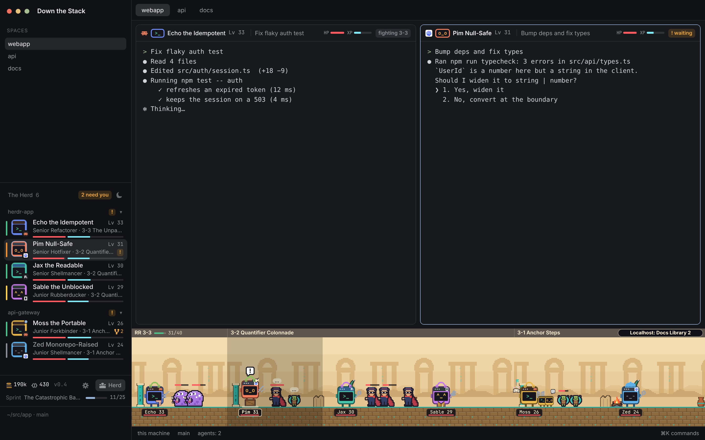

# Down the Stack

Every coding agent in the window becomes a Termling, a small pixel-art hero shaped like a terminal
window whose screen is its face. A 200 px strip under the terminals shows the herd fighting
developer bugs (Typo Sprouts, Null Pointer Frogs, the Deadlock Hydra) while their agents work.
Termlings rest at a campfire when idle, sit on a crate under a white `!` when blocked, and show a
Commit Chest when they ship. The left sidebar lists the herd as hero cards. Each pane header is the
hero's nameplate. The game runs itself, one tick per second, and never asks to be played.

## What you see

Left to right, top to bottom (`layouts/Down-the-Stack.json`):

- **Sidebar**: 268 px wide, background `chrome`.
  - Brand row, 46 px (herdr's `workspace-chrome`, draggable).
  - Spaces list (herdr's `spaces`, weight 1).
  - **The Herd** (weight 1.4): a header "The Herd N" with a calm-mode moon. Under it, one group per
    space, with 44 px hero rows:
    - a status stripe on the left;
    - a mini Termling portrait with its program icon;
    - the name, then "Lv N";
    - the career title, class and map;
    - thin HP (red `#FF5A5F`), XP (cyan `#7FE9F5`) and Fresh Eyes bars;
    - chips, such as a `!` on a blocked hero or a Forkling count, and a hollow map-pin glyph
      beside the level of a hero pinned to its map.

    The header shows "N need you" while an agent, or a sub-agent without a pane, is blocked, and
    that group's header carries a `!`. Heroes whose terminal closed sit in a dimmed, collapsed
    off-duty group. The footer shows gold,
    Snippets, the release number, a settings gear, a **Herd** button, and the zone's Sprint meter.
    While the save is in trouble (read-only, not saving, restored) an amber cue sits above it and
    opens the Herd panel. Below 160 px the list becomes a rail of portraits (the cue: a dot above
    the Herd button; a `!` badge on a portrait whose agent or sub-agent waits).
  - Footer, 69 px (herdr's `workspace-chrome` footer).
- **Work column**:
  - Tabs, 42 px (herdr's `tabs`).
  - The active tab's panes, with 8 px padding and gap, radius 10 and a 1 px border (accent when
    focused). Each pane has a 34 px **nameplate** header. For an agent pane it shows:
    - the program icon;
    - the Termling's screen with its live face;
    - the hero name and level;
    - herdr's own terminal title and folder;
    - 48 px HP and 64 px XP bars when herdr's whole title fits beside them, else 28 px and 36 px
      bars from a pane of about 420 px (herdr's title is cut sooner; its tooltip has all of it).
      No bars before herdr has reported the header's width (its first frame);
    - a status chip on the right (for example "fighting 3-3" in grey, or "! waiting" in amber). The
      chip outranks the bars and the title: it is never clipped.

    Narrow panes drop parts. A non-agent pane gets herdr's plain header.
  - A hidden 368 px side panel (herdr's `files` / `changes`).
- **Stage**: 200 px tall (64 to 420), on a night gradient from `#151126` to `#2E2545`.
  - One room per map, each with a header band: the map name, a kill quota or the Sprint meter.
  - Pixel-art backgrounds per zone: sky bands, a far silhouette layer, props, and a tiled ground
    from y = 160.
  - Termlings stand in fixed slots with a name and level tag under their feet. Mobs face left
    towards them.
  - Chests, campfires, bubbles, damage numbers and banners are drawn over that.
  - One header note at a time in the header band: a note about one hero over that hero's room (by
    the camp when it has none, never over another hero's room), a herd-wide one at the strip's
    right end by the camp. Where the whole text has no room, a short form keeps the point
    ("Tamsin: chest opened Unreviewed", "Hired Nell"), with the whole text in its tooltip; a note
    is cut only between words. The hires of one moment are one note ("Hired 6 contractors: Coda, Tobin
    and 4 more", or "Hired 6 contractors" on a crowded strip; every hire in the tooltip) that stays
    as long as their six notes would.
  - When a zone boss is challenged, its room becomes an arena with the boss (112×96 px art), an HP
    bar and the mechanic's text.
- **HUD**: a hidden 26 px strip with gold, Snippets, the release, the Sprint meter, working /
  blocked / shipped counts and a Herd button, plus an amber cue while the save is in trouble. A
  click anywhere on it opens the Herd panel.
- **Status bar**: 28 px (herdr's `workspace-status`).

Status colours come from the layout's `colors`: working `#4CC38A`, blocked `#F2A93B`, done
`#FFD447`, idle `#8A8F98`. Chrome follows herdr's theme; game colours appear only where they mean
something.

## How it behaves

- **working**: the Termling fights its lane on the 1 Hz beat. Its face is a blinking `>_`, and the
  room's far layer drifts. It earns XP, gold and drops, and Forklings (its sub-agents, half-size
  Termlings) hit too.
- **blocked**: after 2 ticks the hero sits on a crate under a white `!` bubble and its slot dims.
  Everything about it freezes: no damage dealt or taken.
- **done**: the task closes and a pending Commit Chest appears with a SHIPPED ribbon; the face is
  `^_^`. The chest opens with a loot fountain when you look at that terminal. Only results you have
  seen fill the Sprint meter that summons the zone boss.
- **idle**: the hero rests at a campfire with face `-_-`, and shows `z` after 10 minutes.
- **Localhost** (the town): a roster hero of Lv 10 or more whose agent is resting, done or gone
  (the app closed too) is on duty at the **Review Desk**, on days a chest of its was opened with
  full value (today or yesterday); a resting one sits at a small desk with a lamp in its campfire's
  spot. Heroes on duty make LGTMs (about 1 an hour each) into a shelf of 10 per Review Desk level,
  and each chest opened with full value takes one for +10% XP and gold (its coin float reads
  "+1.2k · LGTM"). Once the Review Desk is open the camp chip reads "LGTM ×206" (today's count).
  Autopilot buys the Review Desk's first level once a Lv 10+ hero's work was seen, and the next
  only after a game day whose shelf filled and ran dry. A working, waiting or crashed hero always
  stays in the field; the town adds no toasts, no badge and no dot, and the agent-status chips
  keep the agent's words (the job goes in tooltips and secondary text).
- **New agents**: up to 6 new heroes a game day (it turns at 04:00 local), the first day too. A
  7th new agent plays as a **Contractor**, not on the roster; its tooltips and Roster row say when it
  will be hired ("(contractor)" shows where no hire line does), and it becomes a saved hero, keeping
  its level, kit and look (hoodie and hat colours), at the next 04:00 or when a roster slot frees.
  Until then the save keeps it as a slim record (its name, level, XP, class and place in line, not
  its kit or chests): closing herdr, even across 04:00, or restarting its agent brings it back as
  itself with its space's next terminal, for up to 7 game days without its agent. On
  a full roster a hero below Lv 10 makes room only after 15 minutes off duty, so restarting an
  agent (its pane's terminal ends, a new one starts) keeps its hero: the new terminal takes back
  the hero whose terminal ended in that pane.
- **Terminal gone**: the hero steps into a portal and goes off duty. Its pending chests wait.
- **Clicks**:
  - a Termling or its `!` focuses that agent; a double click opens its character sheet;
  - a sidebar row focuses the agent's pane, and a paneless sub-agent opens in herdr's peek;
  - "N need you" shows the next one waiting, row or sub-agent, each click the next;
  - a row's portrait, or a right click on the row, opens the character sheet (a 760×500 dialog);
  - the Herd button opens the Herd panel (760×520: Localhost (the buildings and the town),
    stash, bug tracker, bosses, roster, digest, settings);
  - the nameplate's hero part focuses the pane and opens the sheet. On hover the nameplate shows
    split, zoom and close buttons.
- **Keys** (optional, `keys.json`, section `layout:Down-the-Stack`): `ctrl-shift-g` toggles the
  stage, `ctrl-shift-s` opens the focused hero's sheet, `ctrl-shift-a` the Herd panel and
  `ctrl-shift-d` calm mode. The palette has one entry, "Down the Stack: Herd panel", which opens
  the panel on its Digest tab in any layout (`mod.open`); herdr's own "Layout: Down-the-Stack" row
  switches to it.
- **Motion**: all motion is native (`.loop`, `.transition`, `.frames`): bobbing, lunges, pacing
  mobs and two-tick damage numbers. Calm mode removes damage numbers, banners and loops and dims
  the stage. The view models only change once per second.
- **Settings** (Herd panel): calm mode, damage numbers, the loot glow minimum rarity (drops below it
  draw no glow or pillar), stage height, the Stage strip switch (shows or hides the stage whoever
  hid it; disabled in a layout without one), the HUD strip, collapse the stage when nothing works (a
  minute after the last hero stops; back when one works; transitions only, so a stage shown or
  hidden by hand stays so, and a start while nothing works collapses nothing; a restart inside
  the minute continues the countdown), three opt-in notifications, and the autopilot master switch
  above the ten per-system switches (off: they show inactive and keep their values; auto-learn's
  re-spends after a respec or class change wait too). "Promotion reviews" starts the Senior and
  Staff Reviews at a 90% win estimate.
- **Digest** (Herd panel): "Opened Unreviewed" first (chests that waited 24 h off duty, at half
  value), then levels, drops, bosses, shipped tasks, a Localhost card (chests LGTM'd, job rank-ups,
  the Uptime) and chests waiting. The Herd button's dot stays
  lit for an Unreviewed chest until the Digest is viewed.
- **Notifications** (opt-in, at most 3 a game day that turns at 04:00 local, never a sound):
  `notify()` toasts for a herd-first boss kill, an LTS or Keepsake drop (a boss's Keepsake too; a
  herd-first kill's Keepsake is named in the kill's toast) and a hero reaching
  Principal. They are raised by live ticks only (no burst after the app was closed) and posted once
  a save that took them landed, so a restart, a hot reload or a second window never repeats one;
  one older than 10 minutes is dropped. A click runs `mod.open` on this mod: `mod.json`'s
  `"overlay"` is the Herd panel on its Digest tab, which opens from any layout. A toast posted while
  the Herd panel is open has no click action, because `mod.open` toggles.

## Built from

- **Layout** `layouts/Down-the-Stack.json`, a root `row`:
  - `sidebar` column: `brand`, then `sidebar-lists` (`spaces` and `party`), then `sidebar-footer`;
  - `work` column: `tabs`, then `work-body` row (`main` and a hidden `panel` stack of `files` and
    `changes`), then `stage`, `hud` (hidden) and `status`.

  `main` is `{ "tab": "active" }` with a pane header of `{ "mod": "down-the-stack", "props": {
  "role": "nameplate" } }`. The root sets `"preview": "mods/down-the-stack/preview.svg"` and the
  `mdr_*` colours.
- **Mod** `mods/down-the-stack/` (`mod.json` has `"place": "none"`, the `"overlay"` that
  `mod.open` opens and the palette entries):
  - `main.js` dispatches on `props().role`: `party`, `nameplate`, `stage`, `hud`, and the
    `sheet` and `herd` dialogs opened with `openOverlay` (the Herd panel also by `mod.open`).
  - `host.js` keeps one game host per window. herdr runs one QuickJS VM per window, so module
    scope is shared by every copy. Once a second the host snapshots `agents()`, `terminals()`,
    `spaces()`, `focused()` and `window()`, ticks the world and runs `down-the-stack.tick` to
    redraw the shown copies (it reads `layout()` first, since herdr toasts a failure when no copy
    is shown). It saves through `readTextFile` / `writeTextFile`, posts notifications with
    `notify()`, and hides and shows the stage for the collapse setting.
  - `game/` is the pure, deterministic engine with no herdr imports. `game/view/` builds the view
    models.
  - `ui/` holds the GPUI renderers: `div`, `image`, `svg`, `.loop`, `.transition` and `.frames`.
- **Shipped mods used**: `workspace-chrome`, `spaces`, `tabs`, `files`, `changes`,
  `workspace-status`.
- **herdr functions**: `agents`, `terminals`, `spaces`, `focused`, `panes`, `props`, `window`,
  `theme`, `settings`, `layout`, `appHome`, `home`, `checking`, `readTextFile`, `writeTextFile`,
  `run`, `openOverlay`, `closeOverlay`, `nextCommand`, `setAgentOrder`, `shared`, `setShared`,
  `notify`.
- **Commands run**: `pane.focus`, `pane.split`, `pane.zoom`, `pane.close` (the nameplate's hover
  buttons), `terminal.peek`, `terminal.pin`, `layout.toggle`, `layout.resize`, `layout.hide`,
  `layout.show`, and its own `down-the-stack.tick`. The keys run `down-the-stack.sheet` /
  `.herd` / `.calm`; main.js also answers `down-the-stack.stage`, `.stage:show` and `.stage:hide`
  (no key by default); the palette entry and a notification's click run
  `mod.open {name: "down-the-stack"}`.
- **Programs and network**: none (no `exec`, no `hc`). Files: only its save folder,
  `<app home>/data/down-the-stack/`.
- **Art**: 169 SVGs generated by `tools/gen-art.mjs` into `mods/down-the-stack/art/`, plus
  `preview.svg`:
  - mobs, bosses, zone backgrounds, most effects and the class accessories are full-colour
    `image()` art;
  - weapons, hats, UI icons and the loot and starburst effects are one-colour `svg()` masks;
  - there is no `<text>`, and the glyphs are drawn as pixels.

## Watch out

- **The folder name is load-bearing.** `down-the-stack` is written in four places. Rename all of
  them together:
  - the layout's `mod` blocks and its `preview` path;
  - the mod's code: `ASSETS` in `ui/kit.js`, `SELF = { mod: "down-the-stack" }` in `host.js` and
    `ui/herdpanel.js`, and the dialogs' `openOverlay({ mod: "down-the-stack", … })` in
    `ui/stage.js` and `ui/party.js`;
  - the palette entry of `mod.json`, `mod.open {"name": "down-the-stack"}`;
  - the `down-the-stack.*` keys of `keys.json`.

  `mod.clone` rewrites only `mods/<name>` paths and `mod: "<name>"` keys in the copied files
  (herdr `mods.rs` `clone_mod_at`). Here those are all in the mod's code, so a clone draws its own
  art, talks to its own copies and saves under `data/<clone>/`. Edit `mod.json`'s `"name"`, the
  layout and `keys.json` by hand (a clone's untouched palette entry is a duplicate of the
  original's, and herdr's palette drops it).
- **Palette entries reach any layout only through app commands.** herdr lists every mod's palette
  entries in every layout, but a `<mod>.<command>` reaches shown copies only: picked elsewhere it
  fails with a "down-the-stack.sheet failed" toast. So the palette's one entry runs `mod.open`
  (the Herd panel on its Digest tab; it toggles), and the sheet and calm mode stay on the keys of
  this layout and on clicks. A second `mod.open` entry for the same mod would be a duplicate.
- herdr has no display title for a layout: Settings, the palette ("Layout: Down-the-Stack") and the
  macOS View > Layout menu show the file name, which is why the file is named after the game. herdr
  names mod actions by the mod folder (the Keys overlay reads "down-the-stack sheet", a failed
  command toasts `down-the-stack.sheet failed`, a mod that fails to load says "down-the-stack did
  not load"), which is why the folder is named after the game too. Folder names are letters,
  digits, `-` and `_` (herdr `mods.rs` `valid_name`), lower case like herdr's own mods, and never
  contain `.`: herdr splits `<mod>.<command>` at the first dot.
- **What it touches**: no network, no programs, no file outside its own folders. It writes only
  herdr's data folder for the mod, and the save there holds task titles and pane, tab and space
  names in plain text. herdr's install flow asks an agent to warn about a mod that reaches the
  network, runs programs or reads outside its folder, so keep it that way.
- **Save**: `<app home>/data/down-the-stack/save.json`, outside the mod folder. Next to it:
  - `save.bak`, the previous good save;
  - `save.broken`, the first save that failed to load, kept aside and never overwritten, then
    `save.broken-1` to `-3`, the newest three;
  - `save.unsaved` (then `-1` to `-3`), a session that ran on a new herd while `save.json` could
    not be read (or one whose `save.json` turns out to be a newer version's, opened read-only).

  herdr's mod API cannot list or delete files without `exec`, so the kept copies are bounded by
  their names: once `-1` to `-3` are taken, `-1` takes `-2`'s text, `-2` takes `-3`'s and the new
  one goes to `-3`, each write expecting the text just read (`writeTextFile` replaces atomically).

  Save trouble shows as a notice on the stage, a cue in the party footer and the HUD, and a band
  in the Herd panel. Hot reload and VM restarts wipe module state and cancel timers without
  `close()`, so the game resumes from the save at any moment. A hot reload keeps the VM: the new
  build takes the old build's world over (`globalThis[Symbol.for(...)]`) instead of rolling back
  to the save, and retires every older host, since a copy whose reload fails keeps running the
  old build.
- **Many hot reloads**: each one keeps the old build's module code (about 2–3 MiB) until herdr
  restarts the VM at 75 % of its heap. After a few dozen edits in one session, GC pauses grow: a
  one-frame error banner on a copy is then a pause inside a render, not a bug. Restart herdr.
- **Text you cut**: herdr's bridge refuses a string holding half of an emoji (a lone UTF-16
  surrogate), and the copy shows its error. Cut outside text (titles, names) with a helper that
  never splits a surrogate pair (`formulas.cutText`), never with a bare `slice`.
- **Notifications**: `<mod>.<command>` reaches shown copies only, so a toast's action uses the app
  command `mod.open` (it opens the `"overlay"` of `mod.json` in any layout, and closes it when run
  again). Post a milestone only after the save that records it landed, or a restart or a second
  window posts it again. Never call `notify` while `checking()`.
- **Hidden blocks persist**: `layout.hide` is kept in the layout's click state
  (`layouts/.state/<layout>.json`) across restarts, and deleting the layout file leaves that file
  behind. A mod that hides its own block must remember that it did (here `herd.cfg.collapsed`,
  plus a per-window note) to show it again, and must not show one hidden by hand. Uninstalling
  should delete the `.state` file too, or a reinstall brings the block back hidden. So the person
  also needs a way back in the game itself: the Settings tab's Stage strip switch runs
  `layout.show` / `layout.hide` on the block found by content, whoever hid it. A stage shown or
  hidden with it is the person's: the collapse drops its note, calls off a running countdown, and
  never shows a stage hidden that way.
- **Contractors are saved slim** (round 5; before it they were never saved, and one waiting across
  a restart at 04:00 came back as a new terminal, hired at Lv 1). Each is a record of about 35–60
  bytes: its number (its id is minus it, and its default name, hoodie and hat follow from that), seat,
  level, XP, class, place in line, the game day last seen and a tag of its terminal's address
  (herdr's core keeps terminals while the app is closed). For a minute after a load a record whose
  terminal is not listed yet keeps its hire, so a newcomer listed first cannot take it. A promoted
  Contractor gets a roster id, so anything drawn from the id (the hoodie colour) is stored with the
  hero (`look`), and its hat keeps its colour through its new item uid.
- **A copy's first frame has no size**: herdr reports `on_size_change` only after laying a frame
  out (gpui-shell's size observer runs in prepaint), so plan the first frame for an unknown width
  (the nameplate draws no bars until it is measured).
- **Restarts look like a new terminal**: an agent restarted in its pane's shell keeps its terminal
  (a fast rebind), but a closed pane's terminal is gone and a new pane gets a new id. Never let a
  hero go the moment its terminal ends: here a hero is let go for a hire only after 15 minutes off
  duty (world time, not the time the app was closed).
- **`herdr-app check`** runs `init` with real file writes and exec. Every read and write is
  guarded by `checking()`; a forgotten guard can overwrite the real save.
- **Paneless sub-agents** (most Forklings): `agent.focus` only picks what an `agent` block shows,
  and this layout has none. Show them with `pane.focus {terminal}` when they have a pane, else
  `terminal.peek {terminal}`.
- **Status `seq`**: herdr's seen flip (done ↔ idle) does not bump an agent's `seq`, so don't gate
  status changes on `seq` alone.
- **`image()` SVGs** are rasterised once at 2× their `width`/`height` and then scaled with a
  linear filter. Art drawn larger than its viewBox (mobs, accessories, the campfire and mug icons,
  the FIXED stamp) carries `width`/`height` = k × viewBox, so always set both `w` and `h`.
- **Loop values are raw px**: multiply both `from` and `to` by `settings().zoom`. Static
  lengths are zoom-scaled by herdr.
- **Budgets**: render ≤ 50 ms, callbacks ≤ 500 ms, module evaluation ≤ 500 ms (herdr loads mods
  in a task scope, not the 5 s "detached" one). Every redraw of any copy redraws the window, so
  never `cx.notify()` from a fast timer. The stage also keeps to about 400 elements and 150
  animated nodes per render: it counts both exactly and thins scenery, then the rigs, then mobs
  on wide stages with many heroes, and last merges status marks into fewer elements (never
  hiding a status cue), holding a level until the finer one fits with room to spare so nothing
  flickers between levels.
- **Installing**: install or update while another layout shows. herdr reloads shown copies within
  about 0.1 s of a file change (it batches app-home events for 80 ms) and can briefly load a mix
  of old and new modules. `cp -r mods/down-the-stack <home>/mods/down-the-stack` over an installed
  copy nests the new build inside the old folder (herdr keeps loading the old one): remove the old
  folder, then copy onto `<home>/mods/`. herdr's own install flow (an agent asked to "Add the layout
  at https://github.com/tyevco/down-the-stack", `defaults/AGENTS.md`) copies `layouts/` and
  `mods/` from this repository, merges its `keys.json`, runs `herdr-app check` and switches; it
  never overwrites, so an update stays a by-hand step.

## Done when

- `herdr-app check <app home>/mods/down-the-stack` passes. In the repo, `npm test` and
  `npm run check` pass, and `npm run qjs -- --only lint,roles,fuzz` (the mod in QuickJS-ng with
  herdr's limits) exits 0.
- After `layout.switch {"name": "Down-the-Stack"}`:
  - the sidebar lists one hero row per agent, grouped by space;
  - each agent pane's header shows its hero's nameplate;
  - the stage shows one Termling per agent.
- A working agent's Termling fights, and its XP bar fills in the sidebar and the nameplate.
- A blocked agent's Termling sits on a crate under a white `!` within a few seconds (2 ticks).
  Clicking it focuses that terminal.
- An agent that finishes while you look elsewhere leaves a pending chest. Looking at its terminal
  opens it.
- `ctrl-shift-g` (once the keys are merged) hides and shows the stage, and so does the Herd panel's
  Settings tab's Stage strip switch, also for a stage the collapse hid.
- A blocked sub-agent without a pane counts in "N need you"; clicking it opens herdr's peek.
- An agent pane about 420 px wide shows the hero's HP and XP bars, with herdr's title cut short
  and whole in its tooltip.
- The seventh new agent of a game day is a Contractor whose tooltip says when it is hired; after
  04:00 it is a saved hero with the same name, level and colours, and the six hires of that
  moment show as one header note. Closing herdr before 04:00 and opening it after brings the
  Contractor back at its level and hires it then.
- On a full roster, restarting a low-level hero's agent in its pane keeps that hero while
  Contractors wait.
- In the Herd panel's Roster at 640 px, two spaces that share a start ("ceo-assistant-res-2",
  "ceo-assistant-writer") read "ceo-assi…res-2" and "ceo-assi…writer"; hovering shows the whole name.
- On an off-duty hero's sheet (Career tab) at 640 px, Rebind lines for agents in
  "ceo-assistant-search-eng" and "ceo-assistant-billing-eng" end "…search-eng" and "…billing-eng";
  the Bind button's hover shows the whole line.
- An off-duty hero's chest that opens Unreviewed shows "Tamsin: chest Unreviewed" (or longer, where
  it fits) by the camp, the whole line in its tooltip.
- Once a hero of Lv 10 or more has had a chest opened by you, the Herd panel's Localhost tab shows
  the Review Desk at level 1 and the stage notes "Localhost: the Review Desk is open" once. A
  resting hero of Lv 10+ whose work you saw today sits at a desk instead of its campfire; the
  moment its agent works it fights again. After its shelf has filled, the next chest you open
  floats "+n · LGTM", and the camp chip reads "LGTM ×n". The party row and pane header still read
  the agent's own status, and its character sheet's header line reads "resting · “<its last
  task>”" (hovering it shows "At the Review Desk · …").
- With "Collapse the stage when nothing works" on, the stage hides a minute after the last agent
  stops working and shows again when one starts.
- With a notification turned on, its milestone posts one toast and no sound. Clicking the toast
  opens the Herd panel on its Digest tab, and restarting herdr does not post it again.
- Quitting and reopening herdr brings the same herd back from `save.json`.
- With no agents, the stage shows an empty-state message, and nothing throws.
